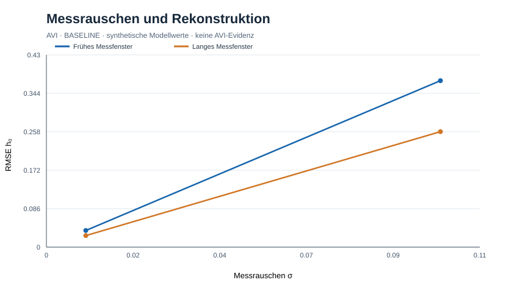

# AVI-OBSERVABILITY-0001 — Reconstruction of a hidden state under measurement noise

Status: BASELINE experiment, 2026-10-25. No empirical AVI claim.

## Research question
Can an unobserved internal initial state h0 be inferred from partial, noisy measurements y(t)=x(t)+epsilon?

## Method
Take the previous full-state reference model x'=v, v'=-x-0.4v+0.3h, h'=-h/2, with x0=v0=0 known and h0=1 held out from the estimator. Integrate via fixed-step RK4 dt=.01. Measurements at t=0, at t=1,2, or at integer t=1..10; IID Gaussian noise sigma=0,.01,.1 in dimensionless position units. For fixed known x0 and v0, linear response x(t)=g(t)h0. Compute scalar least squares estimator h_hat = Σ g(t)y(t) / Σ g(t)^2. Use deterministic random seed 1729 and 200 independent replicates for each case. Numerical observability Gramian W=Σg² and theoretical SD = sigma/sqrt(W) when W>0.

## Verified output (independent execution of equivalent algorithm)
| Sample times | W | sigma | RMSE h0 (200 runs) | Theoretical SD |
|---|---:|---:|---:|---:|
| t=0 only | 0 | any | undefined | undefined |
| t=1,2 | 0.06430329 | .01 | .03723967 | .03943514 |
| t=1..10 | 0.13842070 | .01 | .02583212 | .02687816 |
| t=1,2 | 0.06430329 | .1 | .37239666 | .39435142 |
| t=1..10 | 0.13842070 | .1 | .25832124 | .26878156 |

Noiseless runs recover h0 exactly at these windows; initial-only observation cannot identify h0 even at zero noise. Increased sampling improves information here but does not imply that more samples always resolve structurally unobservable variables.

## Critical limitations
1. The estimator is granted exact x0, v0, model coefficients, independent Gaussian noise, and numerical forward model. Thus this is **conditional** identifiability of h0, not a demonstration that the entire initial state can be identified.
2. Repetition count is 200; finite-sample RMSE differs from analytical SD.
3. If unknown initial x0, v0, model mismatch, correlated noise or unknown boundary conditions are introduced, joint observability and parameter identifiability must be tested anew (rank and singular values of full observation matrix).
4. Gramian values depend on measurement timing, scales, assumed sensor, and noise covariance, and should not be compared outside these conditions without normalization.
5. Identifiability does not establish any nonstandard AVI ontology; a hidden ordinary state suffices.

## Reproduction
```sh
python experiments/avi-observability-gate-0001.py
```
Uses only Python standard library. JSON is printed to stdout; all noise streams are seeded.

## Decision
**PASS: constrained baseline estimator** for this explicit model and observation protocol.
**NOT PASSED: whole-state observability, unknown-coefficient inference or AVI residual validation.**

## Next gate
Infer (x0,v0,h0) jointly from observations of x alone; compute full observability matrix rank/conditioning for short/long windows; evaluate noisy recovery with held-out trajectories, noise-model misspecification, and measurement frequency. Also design unobservable negative-control coupling (h absent from v' equation): no hidden-state inference may succeed there without information leakage.

Related: docs/avi-state-completeness-gate-0001.md, docs/avi-noxia-executable-interface-v0.1.md.

## Abbildung / Visualisierung (Rückpflege 2026-10-25)



[SVG-Abbildung öffnen](figures/avi-observability-gate-0001.svg). Die Darstellung zeigt synthetische Modellergebnisse aus diesem Protokoll und ist **keine empirische AVI-Evidenz**. Die Achsenskalierung und die numerischen Verfahren sind im Versuchsprotokoll bzw. Versuchsskript angegeben. Diese rückwirkend ergänzte Grafik ist nicht mit einer unabhängigen Modellvalidierung gleichzusetzen.
