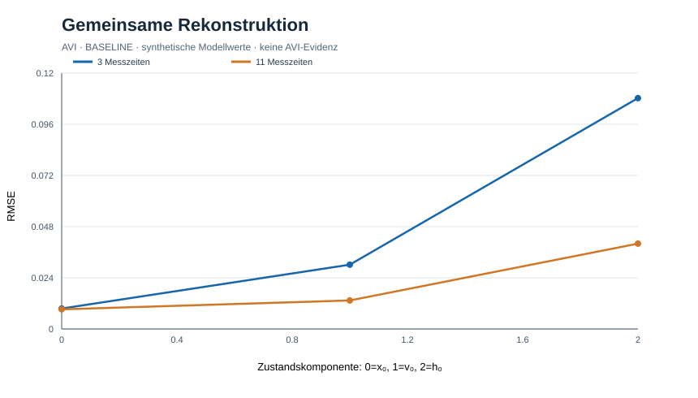

# AVI-OBSERVABILITY-0002: vollständige Zustandsrekonstruktion und Nullkontrolle
Status: BASELINE / ausgeführte numerische Referenz, 2026-10-25.

Modell: x'=v; v'=-x-0.4v+0.3h; h'=-0.5h. Zustand z0=(0.7,-0.2,1); nur Position wird mit unabhängigen Gaußfehlern σ=.01 beobachtet. Anders als Gate 0001 werden alle drei Anfangszustände gemeinsam geschätzt. RK4 dt=.01; 2000 Replikate, Seed 1729. Beobachtungsmatrix H besteht aus den ersten Zeilen des Propagators exp(At), numerisch durch RK4 approximiert. Schätzung per least squares, Rang/Kondition per SVD.

| Szenario | Rang | Konditionszahl | RMSE x0 | RMSE v0 | RMSE h0 |
|---|---:|---:|---:|---:|---:|
| t=0,1,2 | 3 | 14.0492 | .009580 | .030152 | .108266 |
| t=0..10, ganzzahlig | 3 | 6.0474 | .009216 | .013371 | .040023 |
| t=1,2 | 2 | nicht vollrangig | – | – | – |
| entkoppeltes h, t=0..10 | 2 | nicht vollrangig | – | – | – |

Der Kontrollfall setzt die Kopplung A[1,2]=0; die dritte Spalte der Beobachtungsmatrix ist dann exakt null, h bleibt strukturell unbeobachtbar. Die Konditionszahl ist nur für vollen Spaltenrang angegeben: bei Rangmangel darf eine endliche Konditionszahl der verkürzten SVD nicht als Identifizierbarkeit missverstanden werden.

**Entscheidung:** PASS, vollständig beobachtbares *spezifiziertes* Dreizustandsmodell bei ausreichend vielen Positionmessungen. FAIL AS EXPECTED bei nur zwei Zeiten bzw. entkoppeltem h. Dies ist weder eine AVI-spezifische Vorhersage noch ein experimenteller Nachweis zusätzlicher Physik.

**Einschränkung:** Parameter, Modellstruktur, Gaußfehler, Sensor und Sampling sind als bekannt angenommen; unbekannte Parameter, zeitlich korreliertes Rauschen und Modellfehler können Rekonstruktion verschlechtern. Numerische Rangentscheidung ist schwellenabhängig. Vollständiger physikalischer Zustand der Realität kann durch dieses Toy-Modell nicht behauptet werden.

**Nächster Schritt:** unbekannte Parameter und Modellfehlanpassung in getrennten Trainings-/Validierungsfenstern untersuchen; erst danach experimentelle, präregistrierte AVI-Residualhypothese gegen QFT+GR entwickeln.

Reproduktion: `python experiments/avi-observability-gate-0002.py` (numpy).

## Abbildung / Visualisierung (Rückpflege 2026-10-25)

[SVG-Abbildung öffnen](figures/avi-observability-gate-0002.svg). Die Darstellung zeigt synthetische Modellergebnisse aus diesem Protokoll und ist **keine empirische AVI-Evidenz**. Die Achsenskalierung und die numerischen Verfahren sind im Versuchsprotokoll bzw. Versuchsskript angegeben. Diese rückwirkend ergänzte Grafik ist nicht mit einer unabhängigen Modellvalidierung gleichzusetzen.
