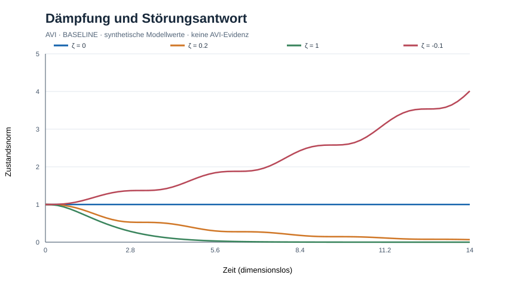

# AVI-ROBUSTNESS-0001 — Erstes Referenzexperiment
Datum: 2026-10-14 · Status: BASELINE ausgeführt, AVI-Effekt nicht getestet

## Ziel
Vergleiche Erholung, Neutralität und Instabilität nach derselben Anfangsstörung. Reines Standardmodell; ausdrücklich kein Nachweis einer AVI-spezifischen Naturregel.

## Modell
Dimensionsloser Oszillator: x'' + 2 ζ x' + x = 0. Anfangsbedingungen x(0)=1, x'(0)=0. Metrik r(t)=sqrt(x²+x'²). Energie E=(x²+x'²)/2. RK4 mit dt=0.04,0.02,0.01; t=0..30. Recovery ist der erste Zeitschritt, nach dem r dauerhaft <=0.05 liegt. Keine Recovery, wenn diese Bedingung innerhalb des Horizonts nie eintritt. Dämpfung ζ<0 ist ein absichtlicher instabiler Negativkontrollfall.

## Ergebnisse (dt=0.01)
| ζ | r(30) | E(30) | Recovery (r<=5%) |
|---|---:|---:|---:|
| 0 | 0.99999999998 | 0.49999999998 | keine |
| 0.2 | 0.00274650 | 0.00000377162 | 14.81 |
| 1 | 4.0368e-12 | 8.1479e-24 | 5.07 |
| -0.1 | 20.29638 | 205.97152 | keine |

Die Messung zeigt qualitativ: physikalische Dämpfung ermöglicht Relaxation; fehlende Dämpfung erhält die Schwingung; negative Dämpfung erzeugt Instabilität. Weder Teleologie noch universelle Fehlerkorrektur folgen daraus.

## Reproduktion
```sh
python -m pip install numpy
python experiments/avi-robustness-0001.py
```
Das Skript schreibt avi-robustness-0001-results.json ins aktuelle Arbeitsverzeichnis und enthält alle drei Zeitschritte zur numerischen Vergleichsprüfung.

## Prüfung & Schranken
- Energie darf bei ζ>=0 im kontinuierlichen Modell nicht zunehmen; numerische Rundungs- und Integrationsfehler separat bewerten.
- Zeitschritt-Konvergenz vergleichen und Unterschiede dokumentieren; diese Notiz behauptet keine vollständige unabhängige Validierung.
- Recovery ist an Metrik, 5%-Toleranz und Beobachtungshorizont gebunden.
- Ein geschlossener, ungedämpfter Oszillator hat keine Relaxation; ausgerechnet dieses Gegenbeispiel verhindert eine triviale universelle Stabilitätsthese.
- Kein AVI-spezifisches Residual getestet. Ein solches benötigt einen vorher formal definierten Zusatz gegenüber einem vollständigen Standard-Basismodell, beobachtbare diskriminierende Vorhersagen sowie unabhängige Evidenz.

## Nächster Gate-Test
Analytische Lösung als unabhängige Referenz und Konvergenztabelle; danach Zustandsvollständigkeit/verborgene Variablen und stochastische Störungen. Keine Integration in produktive NOXIA-Simulation ohne gesonderten Review.

Siehe docs/avi-robustness-0001-stoerung-stabilitaet-unbekanntes.md und docs/avi-noxia-executable-interface-v0.1.md.

## Abbildung / Visualisierung (Rückpflege 2026-10-25)



[SVG-Abbildung öffnen](figures/avi-robustness-0001-experiment-01.svg). Die Darstellung zeigt synthetische Modellergebnisse aus diesem Protokoll und ist **keine empirische AVI-Evidenz**. Die Achsenskalierung und die numerischen Verfahren sind im Versuchsprotokoll bzw. Versuchsskript angegeben. Diese rückwirkend ergänzte Grafik ist nicht mit einer unabhängigen Modellvalidierung gleichzusetzen.
