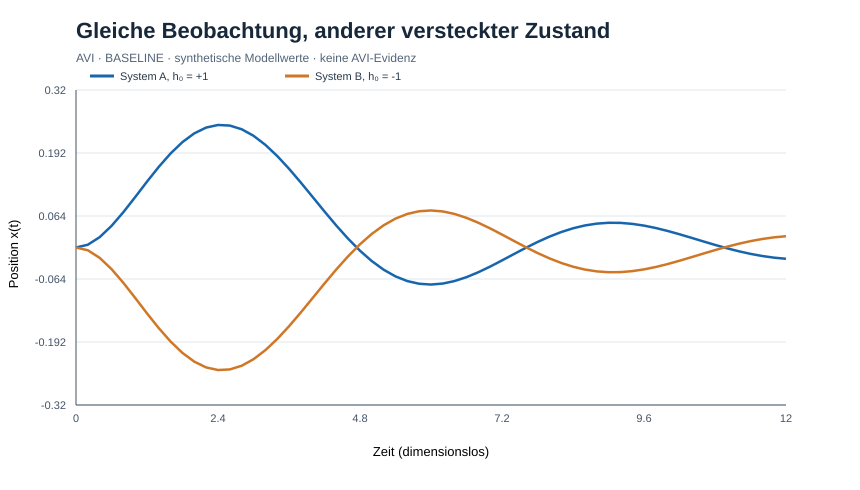

# AVI-STATE-COMPLETENESS-0001 — Gleiche Beobachtung, verschiedene Zustände

**Status:** Referenzmodell experimentell ausgeführt, 2026-10-14.
**Klasse:** BASELINE (Standardmodell, kein AVI-Signal).
**Abhängigkeit:** docs/avi-robustness-0001-stoerung-stabilitaet-unbekanntes.md

## Frage
Zeigen zwei Systeme mit gleichem *reduziert beobachtetem* (x,v) unterschiedliche spätere Reaktionen, wenn eine nicht beobachtete interne Zustandsgröße h abweicht? Verschwinden die Unterschiede bei identischem vollständigem Zustand?

## Modell und Kontrolle
dx/dt=v; dv/dt=-x-0.4v+0.3h; dh/dt=-h/2 (dimensionslos).
A=(0,0,+1), B=(0,0,-1), Kontrollklon C=(0,0,+1).
Numerik RK4, Horizont 20, dt=0.04/0.02/0.01.
Das Modell ist ein gewöhnliches Markov-System, sobald (x,v,h) als vollständiger Zustand behandelt wird. Die Variable h kann als relaxierende interne Anregung gelesen werden; sie wird nicht als AVI-ξ, Φ oder fundamentaler globaler Carrier interpretiert.

## Numerische Ergebnisse
| dt | Max \\|Δx\\| | t bei Maximum | Max \\|Δv\\| | Max \\|A-C\\| |
| --- | ---: | ---: | ---: | ---: |
| 0.04 | 0.4984575 | 2.48 | 0.3149713 | 0 |
| 0.02 | 0.4985064 | 2.46 | 0.3150010 | 0 |
| 0.01 | 0.4985064 | 2.46 | 0.3150107 | 0 |

Bei dt=.01 ist |Δx(20)|=0.00548206. Die Diskretisierung des Zeitpunkts des Maximums erklärt dessen grobe Rasteränderung.

## Schluss
*Different future under same observed variables* bedeutet **nicht** *different future under the same complete state*. Hier ist die ungleiche verborgene Zustandsvariable die vollständige Erklärung. Klon A/C ist numerisch identisch. Das ist ein bewusstes Negativergebnis für vorschnelle AVI-Historieninterpretationen, keine neue Naturbeobachtung.

## Reproduktion
```sh
python -m pip install numpy
python experiments/avi-state-completeness-gate-0001.py
```
Output: avi-state-completeness-gate-0001-results.json.

## Gate für AVI
1. Beobachtete Größen und vollständige Referenzzustandsvariablen ausdrücklich trennen.
2. Standardmodell mit plausiblen internen Freiheitsgraden, Randbedingungen, Gedächtniskernen sowie Messartefakten ausreizen.
3. Prüfen, ob vermeintliche Historienabhängigkeit nach Zustandserweiterung verschwindet.
4. Erst nach vorab definierter AVI-Residualvorhersage, dimensionloser Observable, unabhängiger Messung und statistischem Modellvergleich einen AVI-Test anmelden.
5. Keine Gleichsetzung von numerischer Demonstration und empirischer Evidenz.

**Nächste Aufgabe:** analytische Kontrolllösung und unabhängige Solverprüfung; dann systematische State-Completeness-Sensitivitätsanalyse mit verrauschten Teilbeobachtungen.

## Abbildung / Visualisierung (Rückpflege 2026-10-25)



[SVG-Abbildung öffnen](figures/avi-state-completeness-gate-0001.svg). Die Darstellung zeigt synthetische Modellergebnisse aus diesem Protokoll und ist **keine empirische AVI-Evidenz**. Die Achsenskalierung und die numerischen Verfahren sind im Versuchsprotokoll bzw. Versuchsskript angegeben. Diese rückwirkend ergänzte Grafik ist nicht mit einer unabhängigen Modellvalidierung gleichzusetzen.
